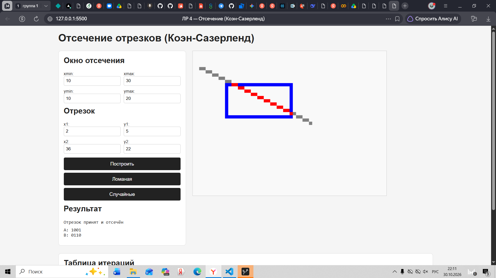

# Лабораторная работа №4 — Отсечение отрезков алгоритмом Коэна-Сазерленда

## Как запустить
Открыть `index.html` в браузере (можно через Live Server в VS Code).

## Используемое окно отсечения
В тестах использовалось окно:
- xmin = 10, xmax = 30
- ymin = 10, ymax = 20

## Соглашение о четырёх битах кода
| Бит | Константа | Значение |
|---|---|---|
| 0001 | LEFT | Точка слева от окна |
| 0010 | RIGHT | Точка справа от окна |
| 0100 | BOTTOM | Точка снизу от окна |
| 1000 | TOP | Точка сверху от окна |
| 0000 | INSIDE | Точка внутри окна |

## Результаты обязательных тестов
1. Полностью внутри: (15, 12) -> (25, 18) — ACCEPT.
2. Полностью слева: (2, 5) -> (8, 15) — REJECT.
3. Полностью сверху: (12, 2) -> (28, 5) — REJECT.
4. Пересекает одну границу: (5, 15) -> (20, 15) — отсекается по LEFT.
5. Пересекает две противоположные: (2, 15) -> (38, 15) — отсекается по LEFT и RIGHT.
6. Проходит через угол: (5, 5) -> (15, 15) — отсекается по LEFT и TOP.
7. Вертикальный: (20, 2) -> (20, 25) — отсекается по TOP и BOTTOM.
8. Горизонтальный: (2, 15) -> (38, 15) — отсекается по LEFT и RIGHT.
9. Обе точки снаружи, но проходит через окно: (2, 2) -> (38, 28) — отсекается.

## Эксперимент со случайными отрезками
Из 50 случайных отрезков вокруг окна получено примерно:
- Принято без изменения: ~5
- Отсечено: ~15
- Отброшено: ~30

Большинство отрезков отбрасываются за счёт быстрой проверки кодов.

## Скриншот работы программы
На скриншоте видно окно отсечения (синий прямоугольник), исходный отрезок (серая линия), результат отсечения (красная линия), а также таблица итераций с шагами алгоритма.

  
   
  <em>Рис. 1. Окно отсечения, исходные отрезки и результат работы алгоритма</em>

