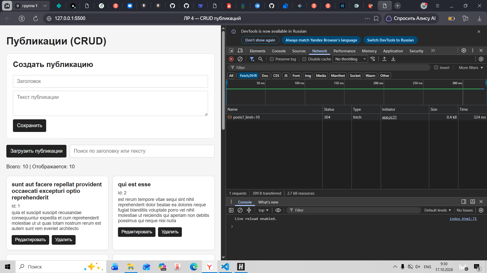
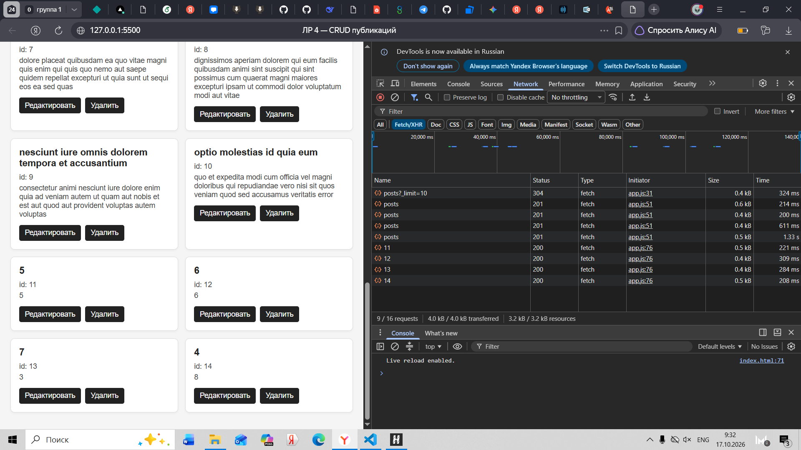
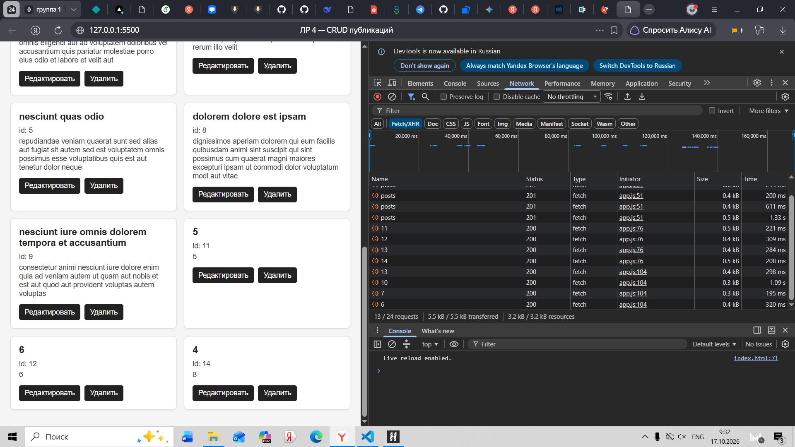

# Лабораторная работа №4 — CRUD-интерфейс для публикаций

## Как запустить
Открыть `index.html` через Live Server (VS Code) или любой локальный сервер. Нажать «Загрузить публикации».

## API
`https://jsonplaceholder.typicode.com/posts`

## HTTP-методы
- `GET /posts?_limit=10` — загрузка списка
- `POST /posts` — создание
- `PATCH /posts/:id` — редактирование
- `DELETE /posts/:id` — удаление

## Состояние приложения
Объект `state` содержит:
- `posts` (массив публикаций)
- `isLoading` (флаг загрузки)
- `isSaving` (флаг сохранения)
- `error` (текст ошибки)
- `filter` (строка поиска)
- `editingId` (id редактируемой записи)

## Обработка ошибок
Все запросы обёрнуты в `try/catch`. Если `response.ok === false`, выбрасывается `Error`. Текст сохраняется в `state.error`.

## Что происходит после успешных запросов
- **POST:** созданный объект добавляется в `state.posts`, форма очищается.
- **PATCH:** объект обновляется в `state.posts`, форма сбрасывается.
- **DELETE:** объект удаляется из `state.posts`.

## Почему изменения исчезают после перезагрузки
JSONPlaceholder — учебный сервер. Он возвращает ответы, но не сохраняет данные в базу.

## Скриншоты

### GET

  

### POST

  

### PATCH

  

### DELETE

  

