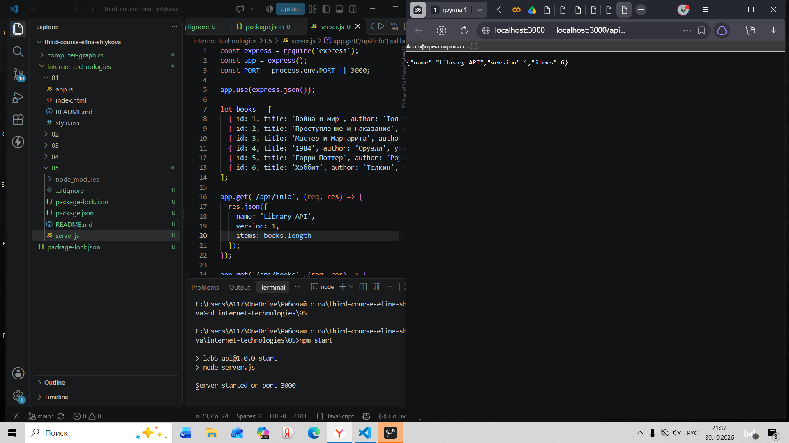
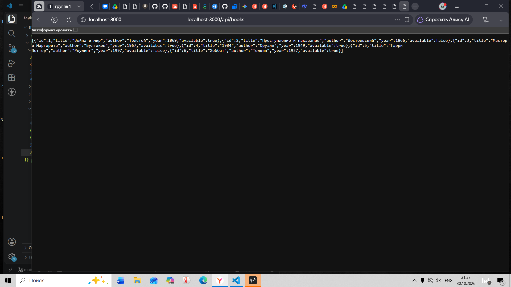
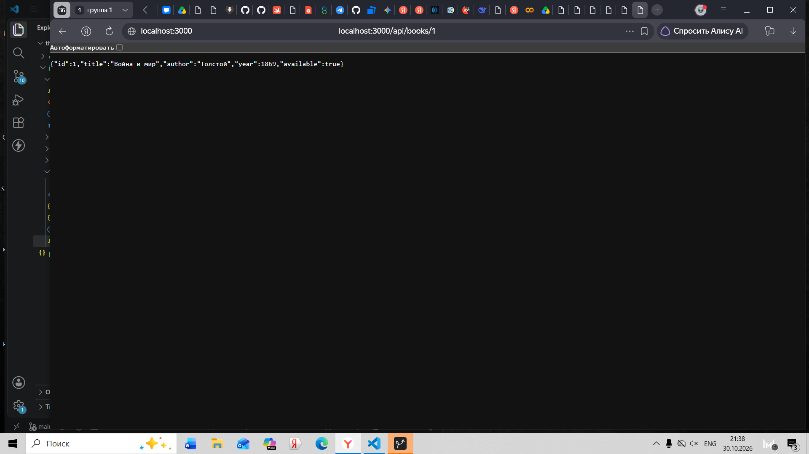
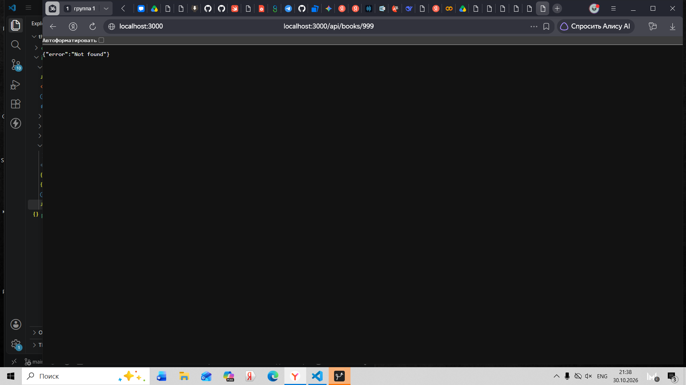
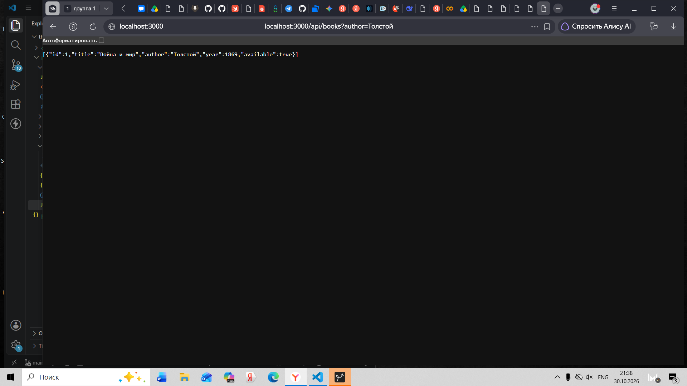
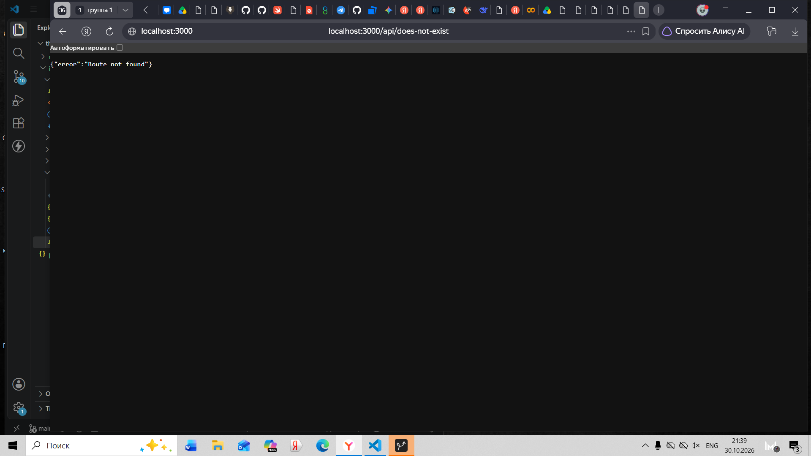
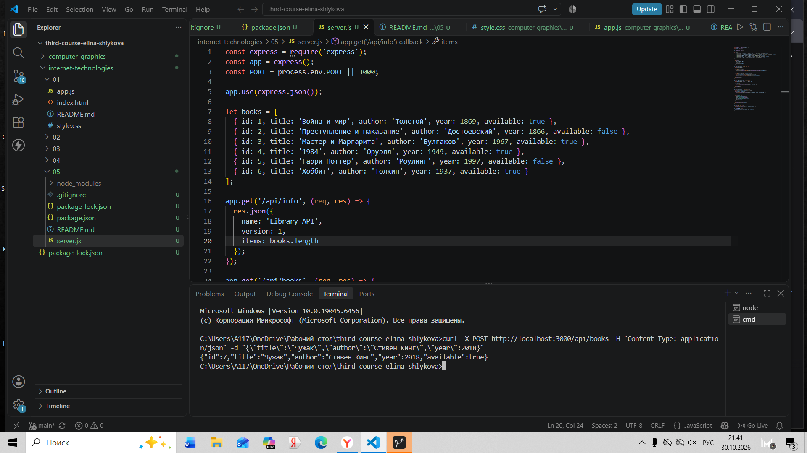
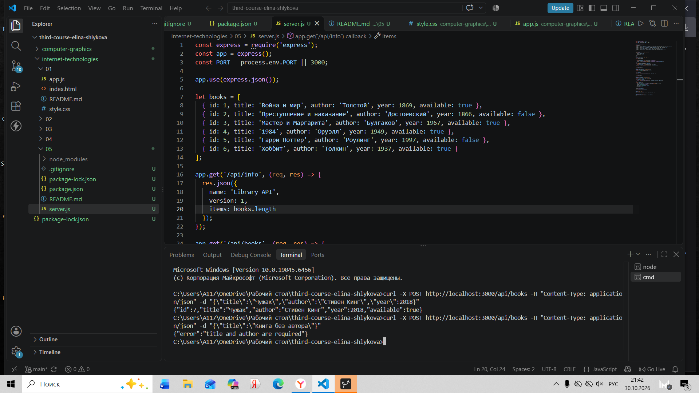

# Лабораторная работа №5 — Собственный REST API (Node.js + Express)

## Установка и запуск
1. Установить зависимости: `npm install`
2. Запустить сервер: `npm start`
3. Сервер доступен по адресу: `http://localhost:3000`

## Выбранная сущность
Книги. Каждый объект содержит поля: `id`, `title`, `author`, `year`, `available`.

## Список маршрутов
| Метод | URL | Описание | Возможные статусы |
|---|---|---|---|
| GET | `/api/info` | Информация о сервере | 200 |
| GET | `/api/books` | Список всех книг (с поддержкой query) | 200 |
| GET | `/api/books/:id` | Одна книга по ID | 200, 404 |
| POST | `/api/books` | Создание новой книги | 201, 400 |

## Примеры query-параметров
- `GET /api/books?author=Толстой` — вернёт книги указанного автора.
- `GET /api/books?available=true` — вернёт только доступные книги.
- `GET /api/books?author=Толстой&available=true` — комбинированный фильтр.

## Примеры запросов

Корректный POST (создание):
`curl -X POST http://localhost:3000/api/books -H "Content-Type: application/json" -d '{"title":"Новая книга","author":"Иван Иванов","year":2024}'`
Ответ: `201 Created` и JSON созданного объекта.

Ошибочный POST (не хватает обязательного поля):
`curl -X POST http://localhost:3000/api/books -H "Content-Type: application/json" -d '{"title":"Без автора"}'`
Ответ: `400 Bad Request` с текстом ошибки.

Несуществующий ID:
`GET /api/books/999` вернёт `404 Not Found`.

Неизвестный маршрут:
`GET /api/does-not-exist` вернёт `404 Not Found` с `{"error": "Route not found"}`.

## Скриншоты проверки API

### 1. Служебный маршрут GET /api/info

  
   
  <em>Рис. 1. Информация о сервере</em>

 

### 2. Получение коллекции GET /api/books

  
   
  <em>Рис. 2. Список всех книг</em>

 

### 3. Получение одного объекта GET /api/books/1

  
   
  <em>Рис. 3. Книга с ID 1</em>

 

### 4. Обработка несуществующего ID (GET /api/books/999)

  
   
  <em>Рис. 4. Ошибка 404 Not Found</em>

 

### 5. Фильтрация через query-параметр (GET /api/books?author=Толстой)

  
   
  <em>Рис. 5. Фильтр по автору</em>

 

### 6. Неизвестный маршрут (GET /api/does-not-exist)

  
   
  <em>Рис. 6. Ошибка для неизвестного маршрута</em>

 

### 7. Создание книги (POST /api/books)

  
   
  <em>Рис. 7. Успешное создание (201 Created)</em>

 

### 8. Ошибка валидации (POST /api/books без автора)

  
   
  <em>Рис. 8. Ошибка 400 Bad Request</em>

