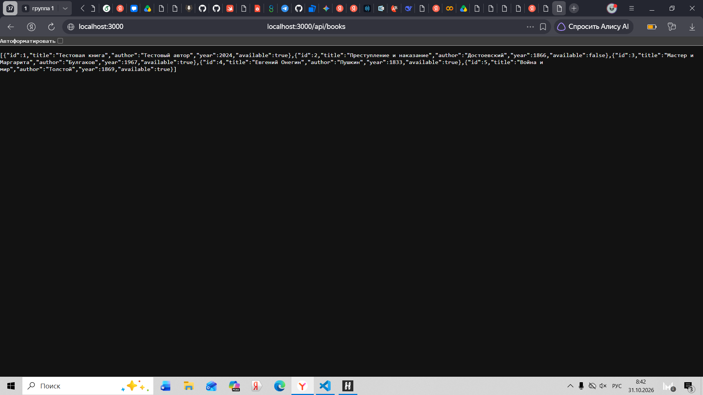
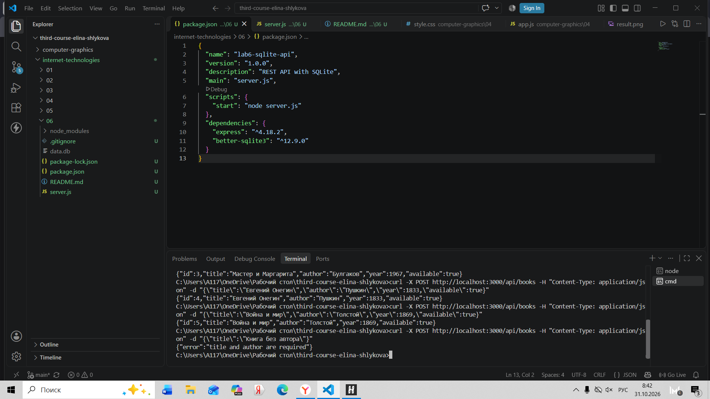
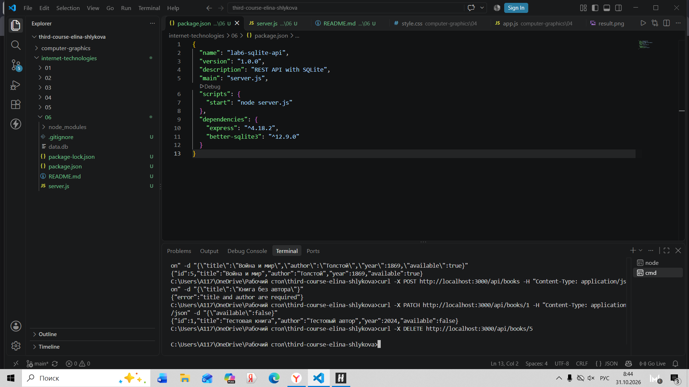
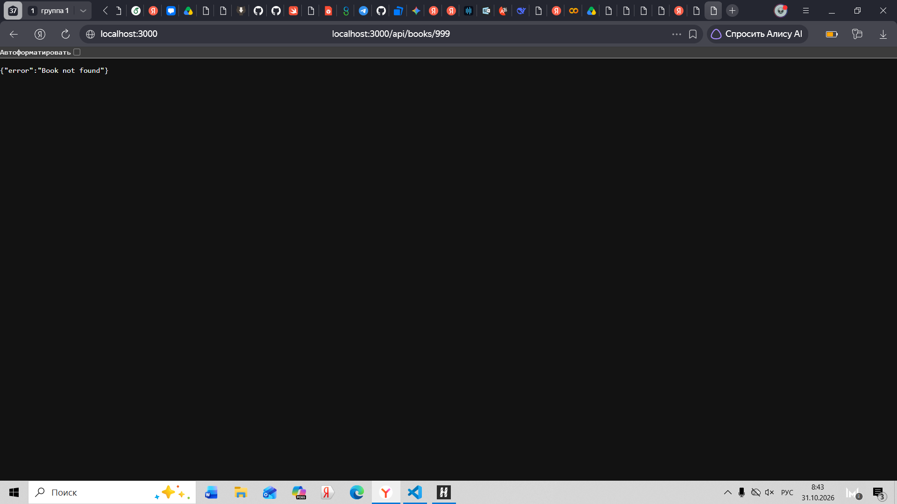
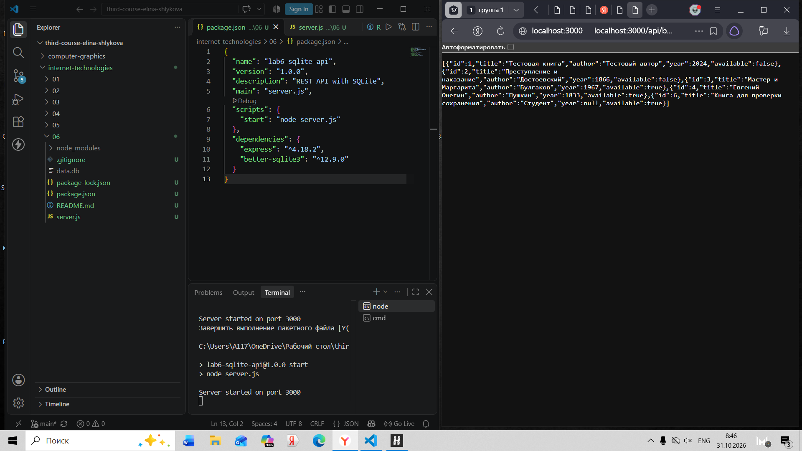

# Лабораторная работа №6 — REST API с SQLite

## Команды установки и запуска
1. Установить зависимости: npm install
2. Запустить сервер: npm start

## Схема таблицы books
Таблица создается автоматически при первом запуске, если ее нет.
- id (INTEGER PRIMARY KEY AUTOINCREMENT)
- title (TEXT NOT NULL)
- author (TEXT NOT NULL)
- year (INTEGER)
- available (INTEGER NOT NULL DEFAULT 1) — хранится как 0 или 1.

## Список маршрутов и используемый SQL
| Метод | URL | SQL | Успешный код | Ошибки |
|---|---|---|---|---|
| GET | /api/info | SELECT COUNT(*) | 200 | — |
| GET | /api/books | SELECT ... (с WHERE) | 200 | — |
| GET | /api/books/:id | SELECT ... WHERE id = ? | 200 | 404 |
| POST | /api/books | INSERT INTO ... | 201 | 400 |
| PATCH | /api/books/:id | UPDATE ... WHERE id = ? | 200 | 400, 404 |
| DELETE | /api/books/:id | DELETE ... WHERE id = ? | 204 | 404 |

## Примеры POST и PATCH
Пример POST-запроса (JSON):
{
  "title": "Новая книга",
  "author": "Иван Иванов",
  "year": 2023,
  "available": true
}

Пример PATCH-запроса (JSON):
{
  "available": false
}

## Query-параметры
- ?author=Толстой — поиск по автору (использует LIKE в SQL).
- ?available=true или ?available=false — фильтр по доступности (использует WHERE available = ?).

## Правила валидации
- Поля title и author обязательны при создании (POST). Если они пустые, возвращается 400 Bad Request.
- При PATCH нельзя сделать title или author пустыми строками (возвращается 400).

## Результат проверки после перезапуска
1. Сервер запущен, создана книга через POST.
2. Сервер остановлен (Ctrl+C), затем запущен снова (npm start).
3. Выполнен GET-запрос на получение этой книги — данные сохранились.
Вывод: данные успешно сохраняются в файл data.db и не теряются при перезапуске сервера.

## Скриншоты проверок

### 1. Получение списка книг (GET /api/books)

  
   
  <em>Рис. 1. Список всех книг в JSON</em>

### 2. Ошибка валидации (POST без автора)

  
   
  <em>Рис. 2. Ошибка 400 Bad Request</em>

### 3. Изменение книги (PATCH /api/books/1)

  
   
  <em>Рис. 3. Успешное изменение записи</em>

### 4. Удаление книги (DELETE /api/books/5)

  
   
  <em>Рис. 4. Удаление записи (204 No Content)</em>

### 5. Несуществующий ID (GET 404)

  
   
  <em>Рис. 5. Ошибка 404 Not Found</em>

### 6. Неизвестный маршрут (404)

  
   
  <em>Рис. 6. Ошибка для неизвестного маршрута</em>

### 7. Сохранение данных после перезапуска сервера

  
   
  <em>Рис. 7. Данные сохранились после остановки и повторного запуска сервера</em>

