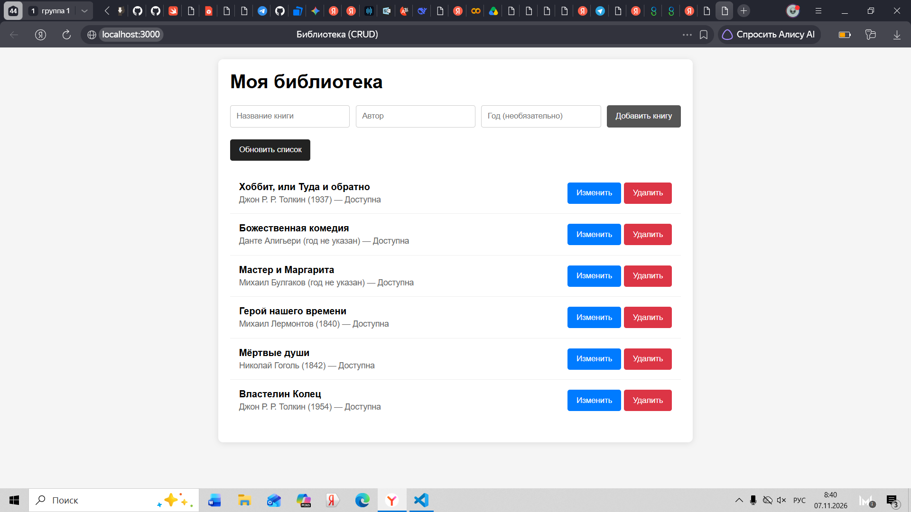
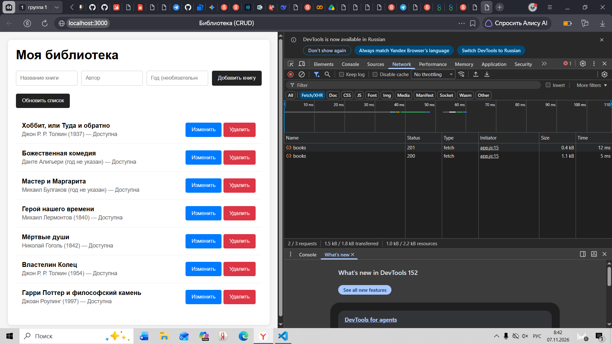
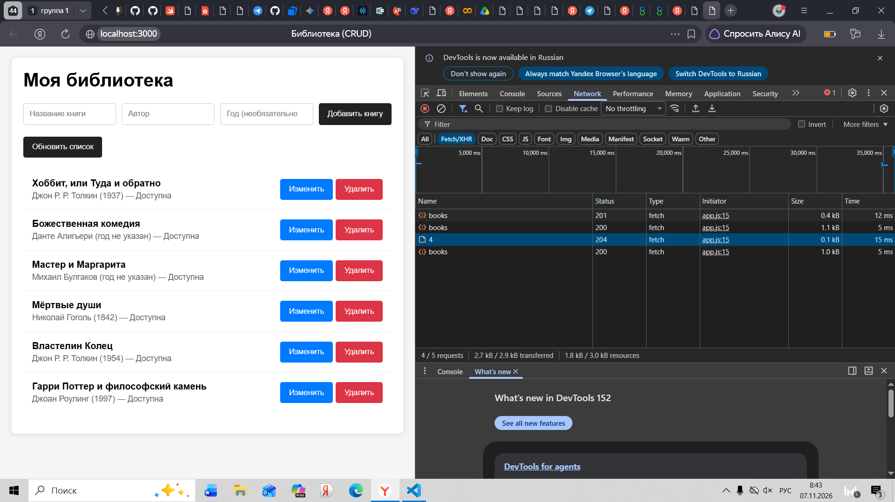
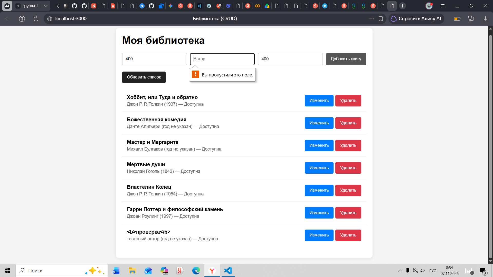
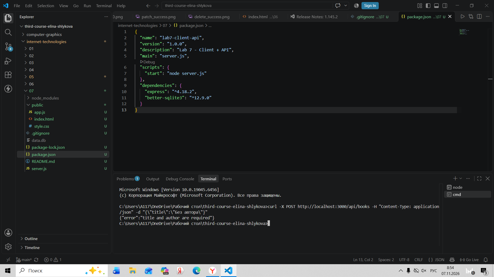
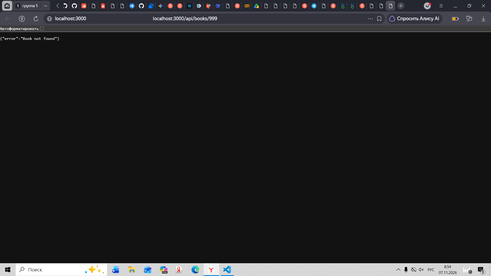
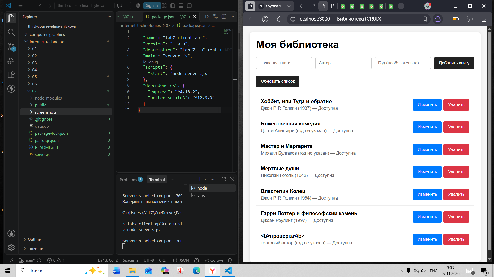
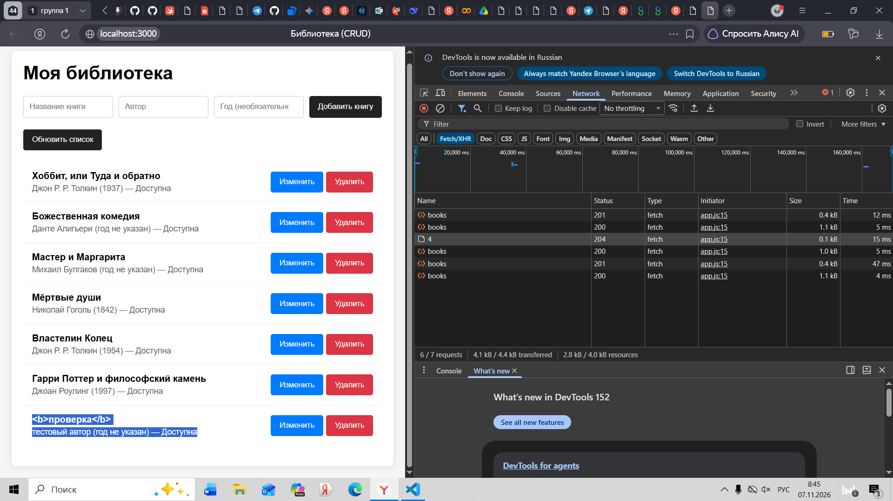

# Лабораторная работа №7 — Браузерный интерфейс для собственного API

## Команды установки и запуска
1. npm install
2. npm start
3. Открыть в браузере: http://localhost:3000

## Структура проекта
- server.js — Express-сервер (API + раздача статики)
- public/ — клиентская часть (HTML, CSS, JS)
- data.db — база данных SQLite (создается автоматически)

## Схема обмена
Браузер → fetch() → Express-маршрут → SQL-запрос → SQLite → JSON-ответ → обновление DOM.

## Список API-маршрутов
| Метод | URL | Описание |
|---|---|---|
| GET | /api/books | Список книг |
| GET | /api/books/:id | Одна книга |
| POST | /api/books | Создание |
| PATCH | /api/books/:id | Изменение |
| DELETE | /api/books/:id | Удаление |

## Действия пользователя в интерфейсе
- Просмотр списка книг (автоматическая загрузка при открытии).
- Добавление книги через форму.
- Изменение названия и доступности (кнопка "Изменить").
- Удаление книги с подтверждением.
- Повторная загрузка списка (кнопка "Обновить").

## Почему textContent, а не innerHTML
При выводе пользовательских данных (название, автор) используется textContent. Это предотвращает XSS-атаки: если пользователь введет <b>Проверка</b>, на странице отобразится текст с угловыми скобками, а не жирный шрифт.

## Проверка сохранения
1. Создана книга через интерфейс.
2. Сервер остановлен (Ctrl+C) и запущен снова (npm start).
3. Страница обновлена — книга отображается в списке.

## Скриншоты

### Главная страница

  
   
  <em>Рис. 1. Главная страница со списком книг</em>

### Запрос POST (создание)

  
   
  <em>Рис. 2. POST-запрос (201 Created) в Network</em>

### Запрос DELETE (удаление)

  
   
  <em>Рис. 3. DELETE-запрос (204 No Content) в Network</em>

### Клиентская валидация (400)

  
   
  <em>Рис. 4. Браузер не дает отправить пустую форму</em>

### Серверная валидация (400)

  
   
  <em>Рис. 5. Сервер вернул 400 Bad Request</em>

### Ошибка 404

  
   
  <em>Рис. 6. Ошибка 404 Not Found</em>

### Сохранение после перезапуска

  
   
  <em>Рис. 7. Данные сохранились после перезапуска сервера</em>

### Безопасный вывод (XSS)

  
   
  <em>Рис. 8. Текст <b>Проверка</b> отображается как текст, а не как HTML</em>

